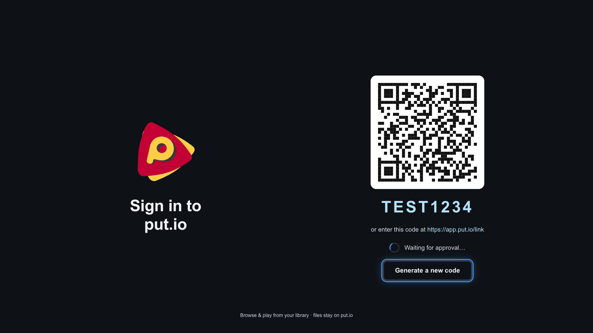
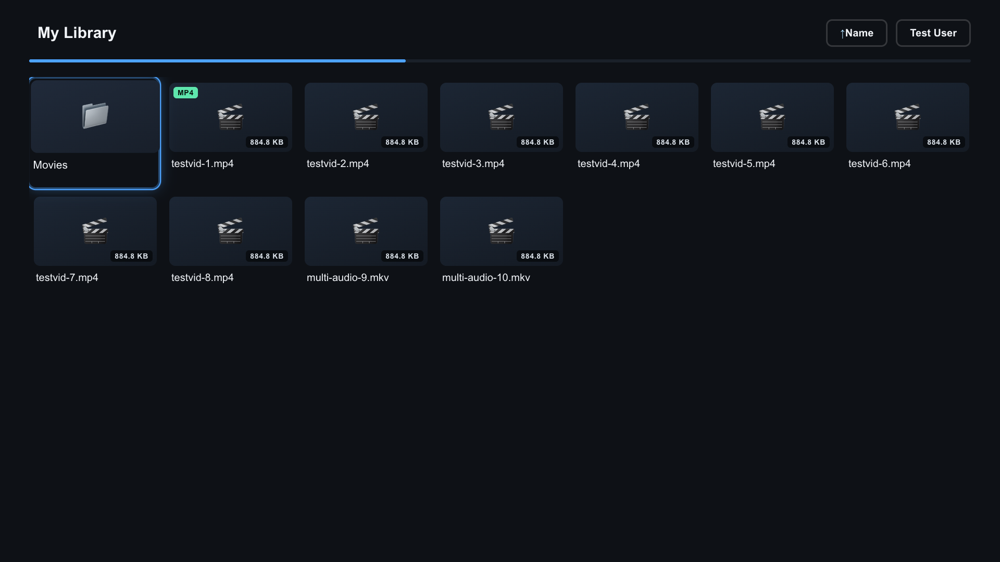
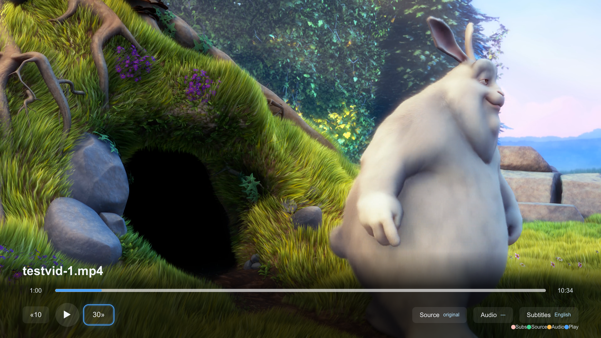
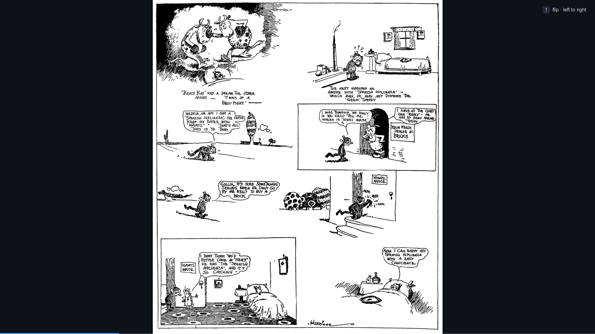
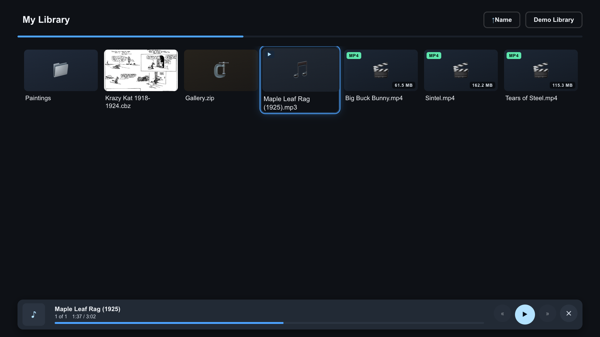
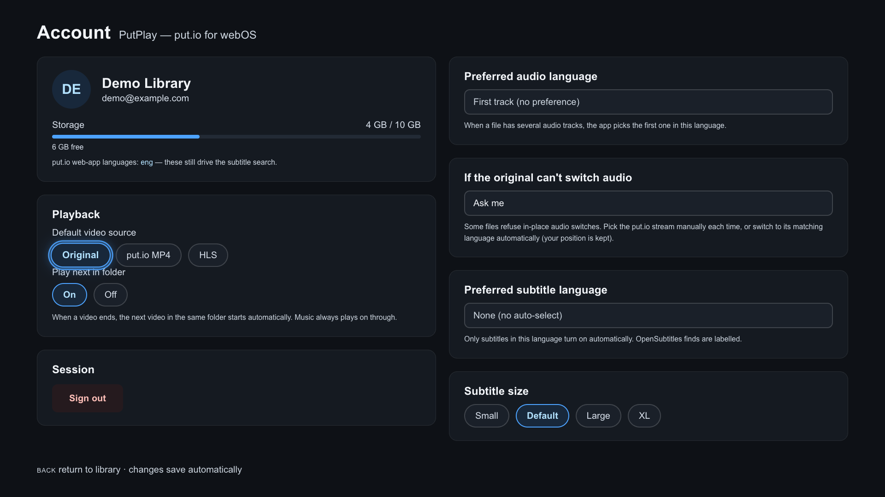

# PutPlay

[](https://github.com/Krule/PutPlay/actions/workflows/ci.yml)
[](https://github.com/Krule/PutPlay/releases/latest)
[](https://github.com/Krule/PutPlay/releases)


put.io on the big screen — original files, embedded subtitles, my remote.

> Unofficial. Not affiliated with put.io or LG.

## Why this exists

A couple of months ago my LG C1 OLED TV stopped working with [put.io](https://app.put.io), a service and an app I occasionally used. The reason why my TV stopped working, I assume, was that they updated their app using either CSS or JS features my TV does not support. Now, I like put.io. I like their apps and there is one I can still use, their [TV App](https://tv.put.io). But there was a reason why I preferred using their main app. The functionality it offers, having been built a long time ago for users with different use cases than mine, is just not what I would choose to use.

Anyway, just like that, my really good TV, with pretty amazing picture quality, became less useful to me. The worst thing, this is not the first time it happened. I've watched my perfectly good hardware degrade in usability over time for a while now. 

Web tech moves on, as it should. On the other hand, webOS 6 (the OS on C1) is built on a variant of Chrome 79. A version of the browser unsupported by Google since 2019. And this browser worked fine until a few months ago when problems started. First, it was CSS, then I was unable to load some websites, and pass the [Cloudflare CAPTCHA verification](https://community.cloudflare.com/t/cloudflare-blocking-smart-tv-browser/352249/6).

I understand that LG and other hardware manufacturers operate with limited resources, don't we all, and that they are not going to support their hardware 5 years after manufacture. But it is still a good piece of hardware and the one I don't intend to turn into e-waste.

Now, this still leaves me with some options. The first is to spend some money and buy something to extend my device's usable lifetime. I am not a big fan of this solution. The second is to accept the situation as it is and live with it. At the end of the day, this was just a small part of the overall experience and I could live with it. But this is obviously not what I did. Instead, I figured, webOS apps are mostly HTML/JS and I know how to deal with that. I don't have a lot of time on my hands, but I also do have a local language model I want to try. I don't even need to root my TV, even though I do want to.

So I outlined this project, put together some resources, some rules and some limitations. And what do you know, a few days later we have PutPlay. Not fully up to my satisfaction, but it's usable and we are iterating over the rough edges. If you care to try, read on!

## What it does

- Browses your put.io library and plays the file **as uploaded** (MKV/MP4) —
  with put.io MP4 and HLS as fallbacks when the original misbehaves
- Subtitles: MKV-embedded first, then your put.io subtitles (ASS/SSA and SRT)
- Audio track switching — and when the TV's player refuses a switch, it tells
  you the truth instead of pretending it worked
- Reads your **.cbz comics**: only the pages you look at are streamed (range
  reads, no full-file download), two pages side by side, left-to-right or
  right-to-left, and it opens back at the page you left
- Opens **.zip/.cbz archives** the same way — browse them without downloading
- Pictures: the image viewer fits the glass, and **OK** steps fit → 2× → 4×
  with arrow panning
- Music files play under a **now-playing strip** while you keep browsing,
  reading, and watching
- Resumes where you left off; remembers your source and language preferences
- Sign-in is a device code: enter it on your phone, or scan the QR

## Screens



Sign-in is a device code — enter it on your phone, or scan the QR.



The library — a `.cbz` tile shows its real cover, cached locally.



The player — the file as uploaded, with source, audio, and subtitle controls. (Frame: Big Buck Bunny, Blender Foundation, CC-BY 3.0.)



The comic reader — two pages a sheet, the direction legend in the corner.


The image viewer — *The Starry Night*, fit to the glass.



Music under a now-playing strip — the library stays fully usable.



Account & settings — source, audio, and subtitle preferences, saved per account.

More in [`docs/screenshots/`](docs/screenshots/); the demo content behind
the shots is open content — see
[`docs/shots/CREDITS.md`](docs/shots/CREDITS.md).

## Controls

Pointer (Magic Remote) and 5-way both work. **OK** confirms, **Back**
cancels — double-press exits.

In the player: **blue** play/pause · **red** subtitles · **yellow** audio ·
**green** playback source.

In the reader and the image viewer: **OK** zooms (fit → 2× → 4×), the
**arrows** pan while zoomed, and **Up** flips a comic's reading direction.
With the music row or a docked video in the corner, **Down** hands focus
between the page and that row; while the row is focused, the arrows
operate the row and never turn the page.

Music: the remote's play/pause, stop, and rewind/forward keys drive the
now-playing strip.

## Installation

Download the current `.ipk` from the [releases page](https://github.com/Krule/PutPlay/releases).

- **Regular TV:** install the `.ipk` through Homebrew Channel (below).
- **Rooted TV (mine):** dev install straight into `appinstalld` — no Developer
  Mode needed. From a checkout, `TV_IP=<your tv> TV_USER=root pnpm deploy:tv`
  copies, installs, and verifies in about four seconds.

### Homebrew Channel

1. On the TV, open **Homebrew Channel** (install it from [webosbrew.org](https://webosbrew.org) if you don't have it).
2. Select **Add App** → **Add from URL**.
3. Paste this repository address and press OK:

   ```
   https://raw.githubusercontent.com/Krule/PutPlay/main/repo.json
   ```

4. Pick **PutPlay** from the list and confirm the install.

Each GitHub release updates this repository automatically, so “check for
updates” in Homebrew Channel picks up new versions on its own.

## Building

```sh
git clone git@github.com:Krule/PutPlay.git
cd PutPlay
npm ci
npm test        # 500+ tests, including the webOS 6 baseline gate
npm run build   # js/bundle.js + js/bundle.css
npm run package # ba.ovo.putplay_<version>_all.ipk in the repo root
```

Releases are tag-driven: push `v1.2.3` and CI builds, tests, packages
`ba.ovo.putplay_1.2.3_all.ipk`, and publishes a release named `v1.2.3` with the
`.ipk` attached. The tag is the version — it's written into `package.json`
and `appinfo.json` at build time, so the file, the app, and the release can
never disagree.

## Compatibility

Built for webOS 6 (my C1). The codebase is pinned to the webOS 6 webview —
Chromium 79 — and a test in the suite keeps it there: no flex `gap`, no
`:focus-visible` outside `@supports`, no ES2020+ APIs. The TV's browser isn't
going anywhere, so the app knows exactly where that line is and stays on
this side of it.

## Disclaimer

This project is unofficial and is not affiliated with, or endorsed by,
put.io or LG Electronics. It uses your own put.io account against the
public put.io API. Use it within put.io's terms.
